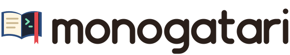

<p align="center">
  <picture>
    <source media="(prefers-color-scheme: dark)" srcset="assets/logo-dark.svg">
    
  </picture>
  <br>
  <a href="https://github.com/unixsuperhero/monogatari/releases"></a>
  <a href="https://pkg.go.dev/github.com/unixsuperhero/monogatari"></a>
  <a href="go.mod"></a>
  <a href="LICENSE"></a>
</p>

<p align="center">Stories for apps built on <a href="https://github.com/unixsuperhero/ochazuke">ochazuke</a>: JSON keystroke scripts played headless against your app's real UI, with expectations on what the screen shows.</p>

<!-- Demo gif goes here once there is one (recorded with vhs, like oden's and ochazuke's):
<p align="center"></p>
-->

A story is a JSON file that names an app, a fixture and a script of keys,
and says what the screen must show afterwards. monogatari plays it against
the app's real `ochazuke.Model`, headless under `go test` or live in a
terminal, so a UI bug becomes a story before it is fixed and a reviewer can
walk an app change key by key without touching anyone's data.

Module `github.com/unixsuperhero/monogatari`; requires Go 1.26 or newer. It
requires [ochazuke](https://github.com/unixsuperhero/ochazuke) and
[oden](https://github.com/unixsuperhero/oden); neither requires it.

> **Status: v0.1.0, early.** The engine is here: the story format, the runner
> and driver, recordings, trimming and the explorer (moved from ochazuke's
> `story` and `explore` packages, which are now frozen and deprecated), with
> the app seam below, and the host (`monogatari/host`: CLI, catalog, index
> TUI, player, explore's watch mode; moved from ochazuke's `o-story`).
> ochazuke's own `o-story` runs on it; the app testers (mtm, o-json) are next.

## What it does

- **Stories.** JSON keystroke scripts with expectations: the focused list,
  the mode, text the screen contains or lacks, the highlighted rows, the
  page. Keys are named as bindings name them (`ctrl+n`, `esc`, `shift+tab`).
- **Headless runs.** Every story runs under `go test` against the app's real
  UI, with a fake clock, jobs and ticks, so a run is the same every time.
- **Recordings.** Every live session is recorded: a ring of the last 5 per
  story, plus named saves you `keep`. `replay` plays one back with its
  timing; `trim` cuts it down to the keys that matter; `run --from` turns
  one into a headless check (`Store`, `Recorder`, `Library.Trim`,
  `Library.Replay`; the commands come with the host).
- **Explorer.** Walks an app's states from a story's start and reports what
  breaks (panics, focus traps, hints that lie, renders that overflow, jobs
  that never settle), each finding written out as a story that reproduces it
  (`monogatari/explore`; `Library.Subject` explores a story's app).
- **A host per app.** CLI subcommands, an index TUI and a player, as an
  [oden](https://github.com/unixsuperhero/oden) command an app mounts under
  its own name (`mtm story ...`), each host with its own user stories and
  recordings (see "The host" below).

monogatari knows no app. An app's behaviour comes in through its fixtures
(named starting states that build its runtime from a seed) as data; the
library never branches on an app's name.

## A story

A story from ochazuke's own suite (`page` is a field of ochazuke's demo
app, which builds a synthetic page from it). `app`, `fixture` and `seed`
name which app to build, from which starting state and with what data; a
story with no `app` runs on the host's first app, with no `fixture` on the
app's first.

```json
{
  "name": "the palette highlights nothing until ctrl+n",
  "area": "palette",
  "page": { "lists": [{ "id": "a", "rows": 3 }] },
  "script": [":", "ctrl+n"],
  "expect": [
    { "after": 1, "highlighted": 0, "dimmed": 1, "mode": "insert", "lacks": ["> "] },
    { "highlighted": 0, "dimmed": 1, "contains": ["> accept"] }
  ]
}
```

An `expect` entry checks the screen after a step (`after`) or, without one,
at the end.

## The app seam

A host registers its apps in a `Library`; there is no built-in app. Each
app has named fixtures, and a fixture builds the app's runtime from what
`Env` gives it and nothing else on the machine:

```go
lib := monogatari.Library{Stories: stories, Apps: []monogatari.App{{
	Name:   "mtm",
	Fields: nil, // top-level story fields this app reads (the demo's: page, pages)
	Fixtures: []monogatari.Fixture{{Name: "seeded", Build: func(env monogatari.Env) (monogatari.Built, error) {
		a := newFakedApp(env.Seed, env.StateDir, env.Now) // temp database, dead socket, fake panes
		return monogatari.Built{Model: a.Model(), Program: a, Close: a.Close}, nil
	}}},
	Expected: func(op, err string) bool { return err == "daemon unavailable" },
}}}
res := lib.Run(story, monogatari.RunOptions{Golden: true})
```

- The host does the generic parts for every app: temp state, config and
  file dirs; the story's settings, `values` and `session` (`Env.Sandbox`,
  or `Env.NewRuntime` for a fixture that builds from scratch); the config
  files loaded after the build; `checks`; theme, size and `chrome`.
- `Built.Program` is the app's own `tea.Model` when it wraps the ochazuke
  model's `Update` and `View`: the driver sends every event to it and the
  frame is its view. `Built.Init` runs its `Init` first; `Built.Start` runs
  after the first frame.
- `reset` (`Env.Reset` from a verb) and a `restart` event rebuild through
  the same fixture; a restart keeps the state directory.
- A story naming an app the host lacks fails with
  `app "mtm" is not in this host (run it with mtm story)`; a top-level field
  its app does not declare in `Fields` fails too.

## Each app builds its own tester

An app links monogatari only in its tester build, behind the build tag
`monogatari`. Its story mount, its fixtures and its fakes live in files
marked `//go:build monogatari`; a `!monogatari` file registers nothing, so a
normal binary compiles and links none of it
(`go tool nm <binary> | grep -c monogatari` is 0).

```sh
go build -tags monogatari -o bin/mtm-story ./cmd/mtm   # the tester, never installed over the app
go test -race -tags monogatari ./...                   # every test, stories included
```

The tester never touches the owner's data: every session gets a temp
database and a socket nothing listens on. In each app:

```sh
mtm-story story run panes              # headless; non-zero exit on failure
mtm-story story open panes/detach-keeps-preview   # live, in the real chrome
mtm-story story history                # the ring: 1 = newest, and the saved names
mtm-story story keep 2 detach-bug      # promote ring entry 2 to a named save
mtm-story story replay detach-bug      # live, with the recorded timing
mtm-story story explore panes          # the state explorer
```

The rules for the tag (tagged files, the `!monogatari` stub, the gate that
runs both builds, the symbol check) are in [AGENTS.md](AGENTS.md).

## The host

Tutorial stories use a reset point and independent actions instead of a script:

```json
{
  "name": "Learn the row motions",
  "fixture": "plain",
  "setup": ["j"],
  "expect": {"focus": "a2"},
  "actions": [
    {"label": "Move down", "caption": "j moves down one row.", "keys": ["j"], "expect": {"focus": "a3"}},
    {"label": "Move up", "caption": "k moves up from the reset point.", "keys": ["k"], "expect": {"focus": "a1"}}
  ]
}
```

`setup` accepts the same key strings and events as `script`. The player shows
setup once from the opening frame, then rebuilds the fixture and replays setup
before **each** action. Edits, registers, config and state files from an action
never leak into the next. `story run` does the same resets headlessly. The
top-level `expect` checks setup (with `after` relative to setup); each action's
optional `expect` checks its keys (`after` relative to that action). Tutorials
need no golden. Use `script`/`base` for existing sequential stories; combining
them with `actions` is an error.
An optional action `id` keeps its inventory identity while `label` uses words
for people.

`story open NAME` opens any story in the player with autoplay running
(400 ms per event by default). `space` or `a` pauses/resumes, `+`/`-` change
the speed, and `l` or `right` steps and pauses autoplay.
`play.action-pause` defaults to `3s` before and after each action, giving time
to read its caption and see its result; `0s` uses the key playback speed.
`[` and `]` jump to the previous/next action's reset point, paused; `r` replays
from the opening frame. Tutorials show one tree: setup steps end at a reset
row, followed by action titles with captions as detail and key steps as
children. Before every action the cursor visibly returns to the reset row,
then walks its key children. Long actions keep their parent and caption in
view while steps scroll. `play.tree` defaults to `true`; false restores the
active-segment column. The host setting `play.captions` defaults to `true`; `:set
play.captions false` hides captions and notes.

All stories support native `notes: [{"after": 1, "note": "What changed"}]`;
actions can also have their own `notes`. An event can carry `note` beside its
`key`, `type`, `paste` or job, shown before that event plays. Apps do not need
to declare a `notes` field. Older `{after, keys, note}` notes keep their key
legend when round-tripped. See
[the independent motions example](host/testdata/stories/tutorials/independent-motions.json).

Compared with Vim: tutorial actions and reset replay have no Vim counterpart;
they are player controls, and never enter the application's key stream.

`monogatari/host` is the tester an app mounts. A `Config` names the host
and what it runs:

```go
cfg := host.Config{
    Prog:    "mtm story",                    // usage and messages; Name defaults to its slug, mtm-story
    Apps:    []monogatari.App{mtmApp()},     // the first is the default app
    Stories: storiesFS,                      // fs.Sub of the embedded stories/
}
root.Add(host.Command(cfg))                  // mtm story ... (an oden command named story)
// or, a tester binary of its own: host.Main(cfg, os.Args[1:], os.Stdout, os.Stderr)
```

and in the app's tests (`Dir` makes `-update` rewrite the goldens on disk):

```go
func TestStories(t *testing.T) {
    cfg.Dir, cfg.Update = "stories", *update
    host.Test(t, cfg) // every story a parallel subtest; a skipped story is a gap
}
```

The commands: `run`, `open`, `list`, `history`, `keep`, `replay`, `trim`,
`explore` (with `--watch` and `--dedupe`), `verbs`, the index TUI with no
words, and the catalog (`catalog`, `NOUN VERB --target ID`):

| noun | verbs |
|---|---|
| `story` | list (`--app`, `--fixture`), show, run, copy (`--as NAME`, to the user's stories with its golden), fixture, recordings, state |
| `recording` | list (`--story NAME`), show, delete |
| `fixture` | list (`--app`), show, stories |
| `application` | list, show, stories, fixtures (the noun `app` is ochazuke's runtime's own) |
| `verb`, `edge` | list (the minimum the stories exercise) |

A relation is one handler on both nouns: `story list --app A` is
`application stories`, `fixture list --app A` is `application fixtures`,
`recording list --story S` is `story recordings`.

With no command, the index splits into the existing story lists on the left
and a preview on the right. Moving focus updates the title, area, fixture,
terminal size, script (keys and assertions), and first frame. Tutorials use
the player's reset point and action tree. First frames are built outside the
update loop, cached for this index session, and clipped to the pane; a loading
placeholder keeps motions responsive while a build runs. Moving away cancels
stale preview requests immediately. Fixture panics and build timeouts appear as
wrapped preview errors alongside the known script, app and fixture names; one
failed or stuck fixture does not hold up the next preview. First frames use the
unfocused tone (`dim-unfocused=0` disables dimming).

`enter` plays the focused story in the right pane with autoplay running.
`p` opens the full-size player with autoplay from the list, or enlarges the
current player while keeping its step and playback state. In a player opened
from the pane, `p` toggles full size; `q` or `esc` returns one level at a time:
full size → pane at the same step → the selected story. A player opened directly
full size returns to the selected story, or `p` brings it into the pane. The
zoom binding is available while `index.preview` is on. `space` pauses or
resumes; `l` or `right` steps. `o` opens a story live for recording.

Player construction runs outside the update loop. The pane shows “Starting…”
while keys remain available; `esc` cancels startup. `play.start-indicator`
defaults to `true` and can hide that indicator. `story.build-timeout` defaults
to `5s` and must be positive; it bounds preview and player startup waits. The
fixture API has no cancellation context, so an abandoned fixture can keep
running until it returns, when its session is closed. Startup errors and
recording results use the full-width status line and clear on the next key.
Hints come from the embedded `host/bindings.json` default rows, so user remaps
appear in the footer and help. Enter falls through from the guarded in-pane
binding to `entry.open` when the preview setting is off.
The existing pane grow/shrink/reset bindings resize the split.

`index.preview` defaults to `true`. Set it to `false` through the Settings
page, `settings set index.preview false`, or the host's `settings.json` to
restore the single-list index and live opening with `enter`. The CLI and TUI
read the same host config directory; no app-specific wiring is required.

Compared with Vim (checked against Vim 9.1's help):

| Vim form | `:help` tag | Story index |
|---|---|---|
| `j` / `k`, `gg` / `G` | `j`, `k`, `gg`, `G` | Similar: existing ochazuke list motions, including area spills |
| `/`, `ctrl+d` / `ctrl+u` | `/`, `CTRL-D`, `CTRL-U` | Similar: existing list filter and half-page motions |
| `:set scrolloff=2` | `'scrolloff'` | Same margin: the index scrolls by screen rows across area boundaries, keeping two lines around focus by default |
| `ctrl+w o` / `:only`, `ctrl+w p` | `CTRL-W_o`, `:only`, `CTRL-W_p` | Similar intent: `p` toggles full size while retaining the pane; `esc` returns one level with its step intact |
| — | — | Fixture construction, cancellation and timeouts: n/a; these have no Vim counterpart |

Each host keeps its own state, under its name (`Config.Name`, default the
slug of `Prog`): user stories (trimmed, copied, hand-made) in
`$XDG_CONFIG_HOME/NAME/stories`, recordings (the ring of 5 and the saved
ones) in `$XDG_DATA_HOME/NAME`. Two hosts on one machine never see each
other's stories or recordings. ochazuke's `o-story` sets `Name: "o-story"`,
so its state stays put whichever command runs it.

## Install

```sh
go get github.com/unixsuperhero/monogatari@latest
```

Requires ochazuke v0.54.0 or newer. For local development against sibling
checkouts, use an untracked `go.work`.

## In the family

monogatari sits above ochazuke and beside the apps' test code. No module
below it requires it, and an app requires it only for its tester build:

| Repo | Relation |
|---|---|
| [ochazuke](https://github.com/unixsuperhero/ochazuke) | monogatari requires it (`Model`, `Runtime`, `cli`, `markdown`, `keytest`). Its `o-story` tool becomes one more host, the host of ochazuke's demo app, in a nested module; the root module never imports monogatari. |
| [oden](https://github.com/unixsuperhero/oden) | The host is an oden command an app mounts, so `mtm story` resolves like any other subcommand. |
| [matomeru](https://github.com/unixsuperhero/matomeru) (`mtm`) | Its `mtm-story` tester mounts the host with fixtures `seeded` and `empty` and its stories under `cmd/mtm/stories/`. Planned. |
| [o-json](https://github.com/unixsuperhero/o-json) | Runs its 14 stories through ochazuke's `story` package by hand today; moves to a tagged `o-json story` mount. Planned. |

Release order: tag ochazuke, then monogatari, then bump ochazuke's nested
modules and the apps' testers (see [AGENTS.md](AGENTS.md), "Releasing").

## Checks

```sh
gofmt -l . && GOWORK=off go vet ./... && GOWORK=off go test ./...
GOWORK=off go test -race ./...   # before a release
```

## Logo

The logo is the Shiori: an open book whose left page is the story script and
whose right page is the live terminal it plays against, with a red ribbon
bookmark for the recording that marks your place. `assets/logo-light.svg`,
`assets/logo-dark.svg` and `assets/icon.svg` are drawn by the family's logo
generator.

## License

MIT; see [LICENSE](LICENSE).
